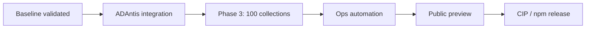

# Roadmap

Organized forward plan from the **validated internal baseline** (30 audited collections, 2026-06-08).  
Phase 3 (100-collection onboarding) is **not started**. No public release tag until explicitly requested.

Priority legend: **Now** = baseline complete · **Next** = Phase 3 prep · **Later** = scale / public · **Future** = standards

---

## Core registry model

| Item | Priority | Status | Notes |
|------|----------|--------|-------|
| Collection Definition Record v1.0.0 | Now | **Done** | JSON Schema + Zod |
| `definition_status` semantics | Now | **Done** | complete / partial / draft |
| Sourced value model (explicit + path) | Now | **Done** | [registry-model.md](registry-model.md) |
| Multi-policy ecosystem notes | Next | Partial | `indexing_notes` only; no `collection_group` schema yet |
| Registry versioning policy | Later | Open | When to bump `registry_version` |
| Creator attestation / signing | Future | Out of scope v1 | Documented in vision |

---

## Parser / extraction capabilities

| Item | Priority | Status | Notes |
|------|----------|--------|-------|
| `extractBySourcePath` | Now | **Done** | Minimal dot-path |
| Five extraction strategies | Now | **Done** | See [trait-mappings.md](trait-mappings.md) |
| GAP-001 `array_singleton_object` | Now | **Resolved** | Mallard Order, Pavia |
| GAP-002 CIP-68 hex trait decode | Later | **Observed** | SpaceBudz only; await 2nd collection |
| EDGE-001 traits string-array split | Later | Open | clay-nation-good-charlotte |
| EDGE-002 split IPFS image join | Later | Open | deprecated-jungle-wenno-cat |
| `normalization_rules` expansion | Later | Minimal | trait rename/value alias only today |
| Full JSONPath / JMESPath | Future | Deferred | Complexity vs payoff |

---

## Audit workflow

| Item | Priority | Status | Notes |
|------|----------|--------|-------|
| Phase input JSON format | Now | **Done** | `research/phase-*-selected.json` |
| `prepare-phase` scaffolding | Now | **Done** | Audits, placeholders, sample dirs |
| Blockfrost sample fetch script | Now | **Done** | `tmp/fetch-phase*-samples.mjs` (manual) |
| Audit template + scoring model | Now | **Done** | A/B/C/D/E classification |
| Findings + schema gap log | Now | **Done** | D-class 2-collection rule |
| Automated Blockfrost in CLI | Next | Not done | prepare-phase reports `skipped_not_implemented` |
| Normalization report in CLI | Next | Script only | `tmp/e2e-normalization-report.mjs` |
| Batch audit dashboard | Later | Not started | For 100+ onboarding |

---

## Dataset scaling

| Item | Priority | Status | Notes |
|------|----------|--------|-------|
| Phase 1 validation (10) | Now | **Done** | |
| Phase 2 discovery (20) | Now | **Done** | Layout diversity, not market cap |
| End-to-end validation (30) | Now | **Done** | 0 failures on samples |
| **Phase 3: ~100 collections** | Next | **Not started** | Requires explicit approval |
| Phase 4: ~500 collections | Later | Planned | Ops process, not schema blocker |
| 1000+ collections | Later | Conditional | Audit capacity bottleneck |
| TapTools CSV pipeline | Next | Partial | `csv/` gitignored; `dataset-analysis.md` |
| Unknown row policy | Next | **Documented** | [top-100-triage-policy.md](../research/top-100-triage-policy.md) — auto-exclude |

---

## ADAntis integration

| Item | Priority | Status | Notes |
|------|----------|--------|-------|
| `@cardano-nft-collection-registry/core` normalizer | Now | **Ready** | `normalizeCollectionMetadata` |
| `@cardano-nft-collection-registry/indexer` | Now | **Ready** | Policy lookup utilities |
| `@cardano-nft-collection-registry/api` | Now | **Ready** | REST over registry JSON |
| Load 30 baseline definitions | Now | **Ready** | `registry/collections/` |
| SpaceBudz partial handling | Next | Required | GAP-002 workaround in ADAntis layer |
| Marketplace trait display | Next | Map normalized output to UI |
| Creator submission flow | Later | Not started | [submission-guide.md](submission-guide.md) draft |
| Sync with cardano-market-orch | Next | Internal | Shared Blockfrost config pattern |

---

## Public registry process

| Item | Priority | Status | Notes |
|------|----------|--------|-------|
| Internal baseline docs | Now | **Done** | This roadmap + internal-baseline |
| Public README accuracy | Now | **Done** | Collection-level rules statement |
| Public preview site | Later | Not started | Static registry browser or API |
| PR-based definition submission | Later | Draft guide exists | No CI gate yet |
| Release tagging / npm publish | Later | **Not requested** | Monorepo private v0.1.0 |
| Community governance | Future | Out of scope v1 | |

---

## Future CIP / standardization

| Item | Priority | Status | Notes |
|------|----------|--------|-------|
| Document as complement to CIP-25 / CIP-68 | Now | **Done** | [cip25-indexing.md](cip25-indexing.md), [cip68-indexing.md](cip68-indexing.md) |
| Collection Definition Record as CIP candidate | Future | Exploratory | [future-cip.md](future-cip.md) |
| Standard extraction strategy enum | Future | In registry already | Could normative in CIP |
| On-chain definition anchor | Future | Not planned v1 | |
| Cross-chain registry pattern | Future | Out of scope | |

---

## Recommended sequence

1. **Now:** Internal baseline frozen (this document set).
2. **Next:** Wire ADAntis marketplace/indexer to core + 30 definitions; handle 3 edge collections explicitly.
3. **Then:** Phase 3 batch selection + audit pipeline hardening.
4. **Later:** Public preview when definition count and submission process justify it.

---

## Explicit non-goals (current phase)

- Phase 3 audits or new collection onboarding
- Schema or parser changes without D-class confirmation
- Public release tag or npm publish
- Per-NFT trait indexing or marketplace pricing data
